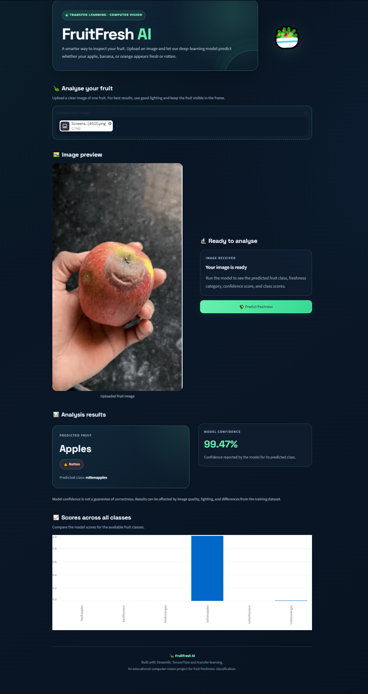

# 🥗 FruitFresh AI — Fruit Freshness Detection Using Transfer Learning

**An image classification application that predicts whether an apple, banana, or orange is fresh or rotten using deep learning and transfer learning.**

Built with **Python, TensorFlow/Keras, EfficientNetB0, and Streamlit**.

[GitHub Repository](https://github.com/iabhishek765/fruit-freshness-detector) · [Dataset](https://www.kaggle.com/datasets/sriramr/fruits-fresh-and-rotten-for-classification)

---

## 📌 Project Overview

FruitFresh AI is a computer vision project that classifies fruit images into six categories based on fruit type and freshness condition.

The project uses **transfer learning with EfficientNetB0** to leverage pretrained image features and adapt the model to fruit freshness classification. A Streamlit web application allows users to upload an image and view the predicted class, confidence score, and scores for all six classes.

### Supported Classes

| Fruit  | Fresh Class    | Rotten Class    |
| ------ | -------------- | --------------- |
| Apple  | `freshapples`  | `rottenapples`  |
| Banana | `freshbanana`  | `rottenbanana`  |
| Orange | `freshoranges` | `rottenoranges` |

## ✨ Features

- Six-class fruit freshness classification.
- Transfer learning using EfficientNetB0.
- Image upload support for JPG, JPEG, PNG, and WEBP.
- Predicted fruit type and freshness condition.
- Model confidence score displayed as a percentage.
- Visualization of prediction scores across all six classes.
- Test-set evaluation using accuracy, precision, recall, and F1-score.
- Confusion matrix for analyzing classification errors.
- Grad-CAM visualization for model interpretability.
- Interactive Streamlit web interface.

## 🧠 Model and Technical Approach

The project follows a transfer-learning workflow:

1. **Dataset preparation:** Load labelled images for the six fruit classes.
2. **Image preprocessing:** Resize images to `224 × 224` pixels and apply the preprocessing required by the model.
3. **Transfer learning:** Use EfficientNetB0 as the pretrained image feature extractor.
4. **Classification:** Train a classification model for the six target classes.
5. **Fine-tuning:** Fine-tune the model as implemented in the training notebook.
6. **Evaluation:** Evaluate predictions on the held-out test dataset.
7. **Interpretability:** Generate a confusion matrix and Grad-CAM visualization.
8. **Application:** Integrate the saved model into Streamlit for image-based predictions.

### Technology Stack

| Technology         | Purpose                              |
| ------------------ | ------------------------------------ |
| Python             | Core programming language            |
| TensorFlow / Keras | Deep learning and model inference    |
| EfficientNetB0     | Transfer-learning backbone           |
| NumPy              | Numerical operations                 |
| Pillow             | Image loading and processing         |
| scikit-learn       | Classification metrics               |
| Matplotlib         | Evaluation visualizations            |
| Streamlit          | Interactive web application          |
| Jupyter Notebook   | Model experimentation and evaluation |

## 📊 Model Evaluation

The current notebook evaluation reports the following results on **2,698 held-out test images**.

| Metric             |     Result |
| ------------------ | ---------: |
| Test Accuracy      | **99.70%** |
| Macro Precision    |     99.69% |
| Macro Recall       |     99.72% |
| Macro F1-Score     |     99.71% |
| Weighted Precision |     99.70% |
| Weighted Recall    |     99.70% |
| Weighted F1-Score  |     99.70% |

These metrics reflect the model's performance on the current dataset's test split. Performance on real-world images may differ because of changes in lighting, backgrounds, camera quality, image angles, and fruit condition.

### Evaluation Artifacts

| Artifact              | File                           |
| --------------------- | ------------------------------ |
| Classification report | `assets/evaluation_report.txt` |
| Confusion matrix      | `assets/confusion_matrix.png`  |
| Grad-CAM example      | `assets/gradcam_example.png`   |
| Dashboard screenshot  | `assets/dashboard.png`         |

## 🖥️ Application Preview

The Streamlit application displays the uploaded fruit image, predicted class, model confidence, and scores for all six classes.




## 🚀 Installation and Setup

Follow these steps to run FruitFresh AI locally.

### Prerequisites

- Python 3.10–3.12
- Git
- The saved model and class-label files included in the repository

A local GPU is not required to run predictions.

### 1. Clone the Repository

```bash
git clone https://github.com/iabhishek765/fruit-freshness-detector.git
cd fruit-freshness-detector
```

### 2. Create a Virtual Environment

**Windows PowerShell**

```powershell
python -m venv .venv
.\.venv\Scripts\Activate.ps1
```

If PowerShell blocks virtual environment activation, run this in the current terminal session:

```powershell
Set-ExecutionPolicy -Scope Process -ExecutionPolicy RemoteSigned
.\.venv\Scripts\Activate.ps1
```

**macOS / Linux**

```bash
python3 -m venv .venv
source .venv/bin/activate
```

### 3. Install Dependencies

```bash
python -m pip install --upgrade pip
python -m pip install -r requirements.txt
```

### 4. Run the Application

From the project root, execute:

```bash
python -m streamlit run app/streamlit_app.py
```

Open the local URL printed in the terminal. By default, it is:

```text
http://localhost:8501
```

### 5. Make a Prediction

1. Upload an image of an apple, banana, or orange.
2. Review the uploaded image.
3. Click **Predict freshness**.
4. View the predicted fruit condition and confidence score.
5. Compare the scores for all six classes.

## 📁 Project Structure

```text
fruit-freshness-detector/
├── app/
│   └── streamlit_app.py
├── assets/
│   ├── confusion_matrix.png
│   ├── dashboard.png
│   ├── evaluation_report.txt
│   └── gradcam_example.png
├── models/
│   ├── class_names.json
│   └── fruit_freshness_model.keras
├── notebooks/
│   └── 01_data_exploration.ipynb
├── src/
│   ├── __init__.py
│   ├── predict.py
│   └── verify_model.py
├── .gitignore
├── requirements.txt
└── README.md
```

## 🔍 Model Inference Details

- Input images are converted to RGB and resized to `224 × 224` pixels.
- The saved Keras model generates scores for the six supported classes.
- The highest-scoring class is returned as the prediction.
- `models/class_names.json` stores the class names used by the prediction code.
- The model's input preprocessing must remain consistent with the preprocessing used during training.

The confidence score is the model's predicted probability for the selected class. It is not a guarantee that the prediction is correct.

## 📚 Dataset

This project uses the **Fruits fresh and rotten for classification** dataset hosted on Kaggle.

**Dataset link:** [Fruits Fresh and Rotten for Classification](https://www.kaggle.com/datasets/sriramr/fruits-fresh-and-rotten-for-classification)

The dataset includes images of fresh and rotten apples, bananas, and oranges.

**License notice:** The dataset page has displayed its license as *Unknown*. Review the current dataset terms and obtain any required permissions before redistributing the original images or dataset-derived materials. The dataset's terms may differ from the license applicable to this project's code.

## 🔮 Future Improvements

Potential future improvements include:

- Testing on a separate collection of real-world fruit images.
- Evaluating robustness under different lighting and background conditions.
- Adding automated tests for invalid or corrupted image uploads.
- Measuring inference latency and model size.
- Improving deployment and reproducibility documentation.

These are potential extensions, not claims about features already implemented.

## 👨‍💻 Author

**Abhishek**

- GitHub: [@iabhishek765](https://github.com/iabhishek765)
- Project: [FruitFresh AI — Fruit Freshness Detector](https://github.com/iabhishek765/fruit-freshness-detector)

---

*Built as a transfer-learning and computer vision project.*
